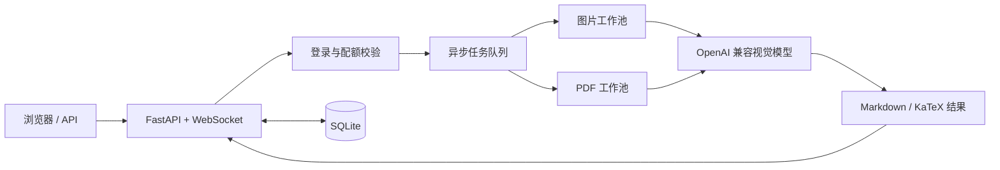

# OCR · 智能图片 / PDF 转 Markdown


一个可自托管的 Web OCR 服务：上传图片或 PDF，调用 **OpenAI 兼容**的多模态模型提取文字，实时查看识别进度，并导出 Markdown（网页端支持 KaTeX 公式渲染）。

内置用户注册登录、按页配额、兑换码、注册令牌与管理后台，既可当在线工具使用，也可通过 HTTP API / WebSocket 接入自有系统。

- 当前仓库：[Qianxia666/ocr](https://github.com/Qianxia666/ocr)
- 问题反馈：[GitHub Issues](https://github.com/Qianxia666/ocr/issues)
- 上游项目：[gua12345/web_oai_ocr](https://github.com/gua12345/web_oai_ocr)

## 目录

- [功能特性](#功能特性)
- [快速开始](#快速开始)
- [首次使用](#首次使用)
- [使用方式](#使用方式)
- [配置说明](#配置说明)
- [项目结构](#项目结构)
- [开发与测试](#开发与测试)
- [常见问题](#常见问题)
- [许可与致谢](#许可与致谢)

## 功能特性

| 分类 | 能力 |
| --- | --- |
| 识别能力 | 图片 OCR、PDF 逐页 OCR、批量上传（API 单次最多 20 个文件） |
| 结果输出 | Markdown 文本、KaTeX 数学公式渲染、逐页查看、导出 JSON / TXT / Markdown |
| 任务体验 | 异步队列、WebSocket 实时进度、失败重试、管理员任务取消、重启后恢复未完成任务 |
| 账户与配额 | 注册登录、按页计费、兑换码、注册令牌、用户协议、系统公告与广播 |
| 管理后台 | 用户与配额管理、兑换码、注册令牌、任务监控、统计与系统资源监控 |
| 安全与防滥用 | Session 登录、可选 Cloudflare Turnstile、同 IP 多账号检测与自动封停 |
| 部署方式 | Docker / Docker Compose、健康检查、SQLite 持久化、运行参数在线调整 |

## 快速开始

### 环境要求

- Docker 与 Docker Compose（推荐），或 Python 3.10+（官方镜像基于 Python 3.12）
- 一个 OpenAI 兼容的 API Key，且所用模型支持图片输入（默认 `gpt-4o`）

### 方式一：Docker Compose（推荐）

```bash
git clone https://github.com/Qianxia666/ocr.git
cd ocr

cp .env.example .env
# 编辑 .env，至少填写 OPENAI_API_KEY 和 MODEL

docker compose up -d
```

> 使用 Compose v1 时，请把 `docker compose` 换成 `docker-compose`。

启动成功后可以访问：

| 入口 | 地址 |
| --- | --- |
| 首页 | `http://localhost:54188` |
| 管理后台 | `http://localhost:54188/admin` |
| API 文档（Swagger） | `http://localhost:54188/docs` |
| 健康检查 | `http://localhost:54188/healthz` |

> `PASSWORD` 是可选的 URL 访问前缀，**不是登录密码**。设置 `PASSWORD=abc` 后，业务页面和 API 路径前需要加上 `/abc`（例如 `/abc/api/async/image`）；留空则不启用前缀。`/login`、`/admin`、`/docs` 不受影响。
>
> 注意：`docker-compose.yml` 在未提供 `PASSWORD` 时会默认使用 `pwd`，首次部署请确认该值。

### 方式二：Docker

```bash
docker build -t ocr-service .

docker run -d \
  --name ocr-service \
  --restart unless-stopped \
  -p 54188:54188 \
  -v "$(pwd)/data:/app/data" \
  --env-file .env \
  ocr-service
```

### 方式三：本地运行

```bash
python -m venv .venv
source .venv/bin/activate        # Windows: .venv\Scripts\activate

pip install -r requirements.txt
cp .env.example .env             # 编辑其中的 API 配置
python main.py

# 也可以指定监听地址和端口
python main.py --host 0.0.0.0 --port 8000
```

> 首次启动会自动创建 SQLite 数据库和所需目录。生产环境请把 `data/` 目录挂载到宿主机，避免容器重建后数据丢失。

## 首次使用

1. 打开首页并注册账号。**第一个注册的用户会自动成为管理员**。
2. 新注册用户默认配额为 **0 页**。管理员可在「管理后台 → 用户管理」调整配额，或生成兑换码让用户自行兑换。
3. 如需关闭公开注册，可在「管理后台 → 系统设置 → 注册功能」中关闭；关闭后使用「注册令牌」邀请注册（支持有效期和最大使用次数）。
4. 登录后即可上传图片或 PDF，查看识别进度并导出结果。

> 公网部署建议：完成首个管理员注册后关闭公开注册，并为管理员设置强密码、启用 HTTPS；需要时再开启 Turnstile。

## 工作流程



图片任务直接送入图片工作池；PDF 会按页渲染成图片后送入 PDF 工作池。识别结果会实时推送到页面，并持久化保存以便再次查看和导出。

## 使用方式

### Web 界面

登录后进入工作台，可以：

- 上传或拖拽图片、PDF，支持一次提交多个文件；
- 查看任务进度、逐页识别结果和错误信息；
- 复制 Markdown，或导出为 `.md` / `.txt` / `.json`。

默认限制为图片 50MB、PDF 200MB / 500 页，可在管理后台调整。

### HTTP API

完整的接口说明和在线调试见 `/docs`。API 使用登录后的 Session Cookie 认证，下面是一个最小示例。

```bash
HOST=http://localhost:54188
PREFIX=            # 设置了 PASSWORD 时填写，例如 PREFIX=/abc

# 1. 登录并保存 Cookie
curl -c cookies.txt -X POST "$HOST/api/auth/login" \
  -H "Content-Type: application/json" \
  -d '{"username":"admin","password":"your-password"}'

# 2. 提交图片任务
curl -b cookies.txt -X POST "$HOST$PREFIX/api/async/image" \
  -F "file=@page.png"

# 3. 查询任务状态
curl -b cookies.txt "$HOST$PREFIX/api/tasks/<task_id>"

# 4. 导出 Markdown
curl -b cookies.txt -OJ "$HOST$PREFIX/api/tasks/<task_id>/export?format=md"
```

PDF 任务使用 `/api/async/pdf`，批量任务使用 `/api/async/batch`（表单字段名为 `files`）。

> 示例假设未启用 Turnstile。若已启用，登录请求需要额外传入 `turnstile_token`。

下表路径均省略了 `PASSWORD` 前缀：

| 方法 | 路径 | 说明 |
| --- | --- | --- |
| `POST` | `/api/async/image` | 提交单个图片任务 |
| `POST` | `/api/async/pdf` | 提交单个 PDF 任务 |
| `POST` | `/api/async/batch` | 批量提交，单次最多 20 个文件 |
| `GET` | `/api/tasks/{task_id}` | 查询任务状态 |
| `GET` | `/api/tasks/{task_id}/result` | 获取识别结果 |
| `GET` | `/api/tasks/{task_id}/progress` | 获取细粒度进度 |
| `GET` | `/api/tasks/{task_id}/export?format=md` | 导出结果（`json` / `txt` / `md`） |
| `WS` | `/ws` | 实时接收任务进度 |
| `GET` | `/healthz` | 健康检查，无需登录 |

### WebSocket

连接 `/ws` 后，可通过消息订阅指定任务的进度：

```json
{"type": "subscribe_task", "task_id": "your-task-id"}
{"type": "ping"}
```

服务端会返回 `task_subscribed`、`pong`、`task_status_response` 等消息，并在任务进度变化时主动推送。

## 配置说明

复制 `.env.example` 为 `.env` 后按需修改。核心配置如下。

> 表中为代码内置默认值；`.env.example` 是配置模板，其中 `PASSWORD`、`TITLE`、`IMAGE_COMPRESSION_RATIO` 的示例值与默认值不同，请按需修改。

### 基础配置

| 变量 | 说明 | 默认值 |
| --- | --- | --- |
| `API_BASE_URL` | OpenAI 兼容 API 地址（程序会自动拼接 `/v1/chat/completions`） | `https://api.openai.com` |
| `OPENAI_API_KEY` | API 密钥 | 无（必填） |
| `MODEL` | 多模态模型名称 | `gpt-4o` |
| `PASSWORD` | 可选的 URL 访问前缀，不是登录密码 | 空 |
| `PORT` | 服务监听端口 | `54188` |
| `HOST_PORT` | Docker Compose 映射到宿主机的端口 | `54188` |
| `TITLE` | 页面标题 | `智能图文识别服务` |
| `FAVICON_URL` | 站点图标地址 | `/static/favicon.ico` |
| `BACK_URL` | 页面「返回」按钮的跳转地址 | 空 |

### 识别、性能与限制

| 变量 | 说明 | 默认值 |
| --- | --- | --- |
| `CONCURRENCY` | 通用并发数 | `5` |
| `IMAGE_CONCURRENCY` | 图片 OCR 并发数 | `2` |
| `PDF_CONCURRENCY` | PDF OCR 并发数 | `2` |
| `MAX_RETRIES` | API 调用最大重试次数 | `5` |
| `PDF_DPI` | PDF 渲染 DPI，越高越清晰也越慢 | `200` |
| `BATCH_SIZE` | 批处理大小 | `8` |
| `IMAGE_COMPRESSION_RATIO` | 图片压缩目标体积比例（0.1 - 1.0，1.0 不压缩） | `0.2` |
| `MAX_IMAGE_SIZE_MB` | 图片大小上限（MB） | `50` |
| `MAX_PDF_SIZE_MB` | PDF 大小上限（MB） | `200` |
| `MAX_PDF_PAGES` | PDF 页数上限 | `500` |
| `API_TIMEOUT` | API 调用超时（秒） | `300` |
| `API_REQUEST_TIMEOUT` | 单次 API 请求超时（秒） | `300` |
| `FRONTEND_POLL_TIMEOUT` | 前端轮询超时（秒） | `300` |

### 安全、前端与存储

| 变量 | 说明 | 默认值 |
| --- | --- | --- |
| `TURNSTILE_ENABLED` | 登录/注册是否启用 Cloudflare Turnstile | `false` |
| `TURNSTILE_SITE_KEY` | Turnstile Site Key，启用时必填 | 空 |
| `TURNSTILE_SECRET_KEY` | Turnstile Secret Key，启用时必填 | 空 |
| `IP_ABUSE_DETECTION_ENABLED` | 是否检测同 IP 多账号滥用 | `true` |
| `IP_ABUSE_ACCOUNTS_THRESHOLD` | 同一 IP 的账户数阈值 | `3` |
| `IP_ABUSE_DAYS_WINDOW` | 检测时间窗口（天） | `7` |
| `TRUST_PROXY_HEADERS` | 是否信任反向代理的 `X-Forwarded-*` 头 | `false` |
| `SESSION_COOKIE_SECURE` | Session Cookie 仅通过 HTTPS 传输 | `false` |
| `CORS_ORIGINS` | 允许的跨域来源，逗号分隔；留空表示 `*` | 空 |
| `DATABASE_PATH` | SQLite 数据库路径 | `data/tasks.db`（容器内 `/app/data/tasks.db`） |
| `RECOVERY_DB_PATH` | 任务恢复数据库路径 | `data/recovery.db` |
| `CHECKPOINT_DIR` | 断点/恢复文件目录 | `data/checkpoints` |

> 并发、超时、大小限制、API 配置、Turnstile、注册开关和 IP 滥用检测都可以在「管理后台 → 系统设置」中在线调整。
> 其中并发/超时/大小限制、API 配置和 Turnstile 的在线修改仅在当前进程生效，重启后恢复为 `.env` 中的值；需要长期生效请直接修改 `.env`。注册开关和 IP 检测配置会保存到数据库。

## 项目结构

```text
.
├── main.py                    # FastAPI 入口：生命周期、认证、兑换码、运行时配置、管理 API
├── core/
│   ├── routes/                # 页面、任务、系统与管理员路由
│   ├── task_manager.py        # 任务调度与图片 / PDF 双工作池
│   ├── task_queue.py          # 异步任务队列与持久化恢复
│   ├── page_processor.py      # 单页 / 批量 OCR 处理
│   ├── ocr_client.py          # OpenAI 兼容 API 客户端与重试策略
│   ├── websocket_manager.py   # WebSocket 连接与进度推送
│   └── recovery_manager.py    # 断点与任务恢复
├── models/                    # SQLite 数据模型（用户、任务、兑换码、注册令牌等）
├── templates/                 # 登录、工作台与管理后台页面
├── static/                    # 静态资源
├── tests/                     # pytest 测试
├── Dockerfile
├── docker-compose.yml
└── .env.example
```

## 开发与测试

```bash
pip install -r requirements.txt
pip install pytest pytest-asyncio httpx

python -m pytest tests/ -q
```

测试会使用临时 SQLite 数据库，不会写入 `data/`。修改代码后也可以用 `python -m compileall -q main.py core models tests` 做一次语法检查。

## 常见问题

**识别失败，日志提示认证失败或模型不存在？**
检查 `API_BASE_URL`、`OPENAI_API_KEY` 和 `MODEL` 是否匹配你的服务商。`API_BASE_URL` 填写 API 根地址即可（如 `https://api.openai.com`），不要包含 `/v1`，程序会自动追加 `/v1/chat/completions`。同时确认该模型支持图片输入。

**注册后没有配额，无法识别？**
新用户默认配额为 0 页。请让管理员在后台调整配额，或使用管理员生成的兑换码兑换页数。

**设置了 `PASSWORD` 后部分页面或接口 404？**
`PASSWORD` 是 URL 前缀。设置后，业务页面和 `/api`、`/ws`、`/process` 路径都要加前缀，例如 `/abc/api/async/image`。

**公网部署后登录状态异常或拿不到真实客户端 IP？**
在反向代理后部署时，请设置 `TRUST_PROXY_HEADERS=true`，并由代理正确传递 `X-Forwarded-For` / `X-Forwarded-Proto`。使用 HTTPS 时建议同时设置 `SESSION_COOKIE_SECURE=true`。

**页面样式或公式没有加载？**
页面从 CDN 加载 Tailwind CSS、marked 和 KaTeX。内网或离线环境需要自行下载这些资源并改为本地引用。

**重启后任务数据会丢失吗？**
不会，但前提是 `data/` 已持久化挂载。服务会从数据库和检查点恢复未完成任务；无法恢复的任务会标记为失败，并按未处理页数退还配额。

**如何升级？**

```bash
git pull
docker compose up -d --build
```

升级前建议先备份 `data/` 目录。

## 许可与致谢

本项目基于 [gua12345/web_oai_ocr](https://github.com/gua12345/web_oai_ocr) 二次开发，遵循 [GPL-3.0](LICENSE) 许可证。

使用本项目时，请遵守所在地区的法律法规、GPL-3.0 许可证条款，以及所接入模型服务商的使用条款。
