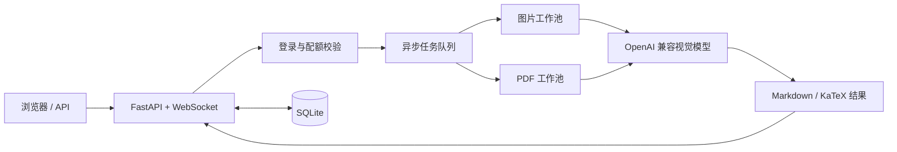

# OCR · 智能图片 / PDF 转 Markdown


一个可自托管的 Web OCR 服务：上传图片或 PDF，调用 **OpenAI 兼容**的多模态模型提取文字，实时查看识别进度，并导出 Markdown（网页端支持 KaTeX 公式渲染）。

内置用户注册登录、按页配额、兑换码、注册令牌与管理后台，既可当在线工具使用，也可通过 HTTP API / WebSocket 接入自有系统。

- 当前仓库：[Qianxia666/ocr](https://github.com/Qianxia666/ocr)
- 问题反馈：[GitHub Issues](https://github.com/Qianxia666/ocr/issues)
- 上游项目：[gua12345/web_oai_ocr](https://github.com/gua12345/web_oai_ocr)

## 目录

- [功能特性](#功能特性)
- [部署指南（零基础）](#部署指南零基础)
- [首次使用](#首次使用)
- [使用方式](#使用方式)
- [配置说明](#配置说明)
- [项目结构](#项目结构)
- [开发与测试](#开发与测试)
- [常见问题](#常见问题)
- [许可与致谢](#许可与致谢)

## 功能特性

| 分类 | 能力 |
| --- | --- |
| 识别能力 | 图片 OCR、PDF 逐页 OCR、批量上传（API 单次最多 20 个文件） |
| 结果输出 | Markdown 文本、KaTeX 数学公式渲染、逐页查看、导出 JSON / TXT / Markdown |
| 任务体验 | 异步队列、WebSocket 实时进度、失败重试、管理员任务取消、重启后恢复未完成任务 |
| 账户与配额 | 注册登录、按页计费、兑换码、注册令牌、用户协议、系统公告与广播 |
| 管理后台 | 用户与配额管理、兑换码、注册令牌、任务监控、统计与系统资源监控 |
| 安全与防滥用 | Session 登录、可选 Cloudflare Turnstile、同 IP 多账号检测与自动封停 |
| 部署方式 | Docker / Docker Compose、健康检查、SQLite 持久化、运行参数在线调整 |

## 部署指南（零基础）

> 整个部署过程分为 6 步：安装 Docker → 准备 API Key → 下载项目 → 填写 `.env` → 启动服务 → 注册管理员。下面按顺序详细说明，照着复制命令即可。

### 部署前准备

| 需要准备 | 说明 |
| --- | --- |
| 一台电脑或服务器 | 普通电脑即可；云服务器建议 2 核 4GB 内存以上 |
| Docker | 用来运行本服务，第 1 步会教你安装 |
| 模型 API Key | 来自 OpenAI 或任意兼容 OpenAI 协议的服务商 |
| 支持图片的模型名 | 例如 `gpt-4o`，模型必须能接收图片 |

### 第 1 步：安装 Docker

**Windows / macOS**

1. 打开 [Docker Desktop 下载页](https://www.docker.com/products/docker-desktop/)。
2. 下载对应系统的安装包并安装。
   - Windows 安装时如果提示启用 WSL2，按提示开启并重启电脑。
   - macOS 根据芯片选择 Apple Silicon 或 Intel 版本。
3. 安装完成后启动 Docker Desktop，等待鲸鱼图标显示为运行状态。

**Linux**

按官方文档安装 Docker Engine 和 Compose 插件：[Docker Engine 安装指南](https://docs.docker.com/engine/install/)。

安装完成后打开终端验证：

```bash
docker --version
docker compose version
```

两条命令都能输出版本号，说明安装成功。如果提示 `docker compose` 不是有效命令，请先启动 Docker Desktop，或安装 Compose 插件。旧版本系统可能只有 `docker-compose` 命令，后续命令把 `docker compose` 换成 `docker-compose` 即可。

### 第 2 步：准备 API Key 和模型

本服务通过 OpenAI 兼容接口调用模型，需要在 `.env` 中填写三项：

| 配置项 | 填什么 | 示例 |
| --- | --- | --- |
| `API_BASE_URL` | 服务商的 API 根地址，**不要带 `/v1`** | `https://api.openai.com` |
| `OPENAI_API_KEY` | 服务商提供的 API Key | `sk-xxxxxxxx` |
| `MODEL` | 支持图片输入的模型名称 | `gpt-4o` |

- 使用 OpenAI 时，可在 [OpenAI API Keys](https://platform.openai.com/api-keys) 创建 Key。
- 使用其他服务商或中转服务时，填写对方提供的地址、Key 和模型名即可。
- API Key 等同于密码，不要发到群里、截图里，也不要提交到 GitHub。

### 第 3 步：下载项目

**方式 A：不安装 Git（推荐给新手）**

1. 打开 [https://github.com/Qianxia666/ocr](https://github.com/Qianxia666/ocr)。
2. 点击绿色 `Code` 按钮 → `Download ZIP`。
3. 解压到一个**路径中不含中文和空格**的目录，例如 `D:\ocr` 或 `~/ocr`。

**方式 B：使用 Git**

```bash
git clone https://github.com/Qianxia666/ocr.git
cd ocr
```

后面的命令都要在**项目文件夹**中执行。判断方法：该文件夹里能看到 `docker-compose.yml`、`main.py` 和 `.env.example`。

- Windows：打开项目文件夹，点击顶部地址栏，输入 `cmd` 后回车。
- macOS：打开「终端」，输入 `cd `（注意有空格），把项目文件夹拖进终端窗口后回车。
- Linux：在项目文件夹中右键选择「在终端中打开」。

### 第 4 步：创建并填写 `.env`

复制配置模板：

**Windows（命令提示符）**

```bat
copy .env.example .env
notepad .env
```

**macOS / Linux**

```bash
cp .env.example .env
nano .env
```

也可以用 VS Code 打开项目文件夹，把 `.env.example` 复制一份并改名为 `.env`，再编辑 `.env`。

至少修改下面几行，其余保持默认：

```env
API_BASE_URL=https://api.openai.com
OPENAI_API_KEY=sk-xxxxxxxxxxxxxxxx
MODEL=gpt-4o
PASSWORD=myocr
```

填写说明：

- 等号两边不要加空格，值不需要加引号。
- `PASSWORD` 是**网址前缀**，不是登录密码。填写 `myocr` 后，登录后的主页是 `http://localhost:54188/myocr`；请换成自己容易记住的英文字母和数字。
- 如果保留 `.env.example` 里的 `PASSWORD=your-password-here`，前缀就会是 `your-password-here`；如果留空或删除这一行，Docker Compose 会默认使用 `pwd`。所以请明确填一个值。
- `.env` 保存着 API Key，不要删除、不要上传，也不要提交到 Git。

### 第 5 步：启动服务

在项目文件夹中执行：

```bash
docker compose up -d --build
```

第一次启动会下载镜像并安装依赖，等待命令执行结束即可。然后检查容器状态：

```bash
docker compose ps
```

当 `STATUS` 显示 `Up`（健康检查通过后还会显示 `healthy`）就表示启动成功。查看实时日志：

```bash
docker compose logs -f
```

看到 `应用启动完成` 和 `Uvicorn running on http://0.0.0.0:54188` 即正常。按 `Ctrl + C` 只会退出日志查看，不会停止服务。

也可以直接用浏览器打开：

```text
http://localhost:54188/healthz
```

看到 `{"status":"healthy",...}` 说明服务正常。

> 使用期间请保持 Docker Desktop 处于运行状态；关闭 Docker Desktop 后服务会停止。
>
> 如果提示端口已被占用，把 `.env` 里的 `HOST_PORT` 改成另一个数字（如 `8080`），重新执行 `docker compose up -d --build`，然后访问 `http://localhost:8080`。

### 第 6 步：打开网页并注册管理员

1. 浏览器访问 `http://localhost:54188`（改过 `HOST_PORT` 就用对应端口）。
2. 点击「注册」，填写用户名和密码。
3. **第一个注册的账号会自动成为管理员**。
4. 如果 `PASSWORD=myocr`，登录后页面会自动跳转到 `http://localhost:54188/myocr`，建议收藏该地址。
5. 管理后台地址：`http://localhost:54188/admin`。

注册后的配额、关闭公开注册、生成兑换码等操作，请看下一节「首次使用」。

> 公网部署建议：完成首个管理员注册后关闭公开注册，并为管理员设置强密码、启用 HTTPS；需要时再开启 Turnstile。

### 部署完成检查

- [ ] `docker compose ps` 中容器状态为 `Up`
- [ ] 浏览器能打开 `/healthz` 并显示 `healthy`
- [ ] 首页能正常打开并完成注册
- [ ] 上传一张图片能正常识别

### 停止、重启、升级与备份

```bash
docker compose logs -f          # 查看实时日志
docker compose stop             # 停止服务（保留容器和数据）
docker compose start            # 再次启动
docker compose restart          # 重启
docker compose down             # 停止并删除容器（data/ 数据仍在）
docker compose up -d --build    # 重新构建并启动，升级代码后用
```

- 用户、任务、配额等数据都在项目目录的 `data/` 文件夹中。
- 备份：直接复制整个 `data/` 文件夹。
- 升级：先备份 `data/`，Git 用户执行 `git pull`，ZIP 用户重新下载并覆盖代码，最后执行 `docker compose up -d --build`。

### 部署常见问题

**`docker: command not found` 或 `docker compose` 不是有效命令？**
说明 Docker 未安装或没有启动。先启动 Docker Desktop，再执行 `docker --version` 和 `docker compose version` 验证。

**Docker Desktop 一直启动失败或卡在启动中？**
Windows 需要开启 CPU 虚拟化（在 BIOS/UEFI 中设置）并启用 WSL2；可先在 PowerShell 中执行 `wsl --update`，再重启 Docker Desktop。macOS 请确认已允许 Docker Desktop 的系统权限。

**端口被占用 / `port is already allocated`？**
修改 `.env` 中的 `HOST_PORT`（例如改为 `8080`），重新执行 `docker compose up -d --build`。

**浏览器打不开，提示无法连接？**
先执行 `docker compose ps` 确认容器是 `running`，再执行 `docker compose logs --tail=100` 查看报错。常见原因是 Docker 没启动、端口未放行或 `.env` 填写错误。

**日志提示 401、403 或模型不存在？**
检查 `API_BASE_URL`、`OPENAI_API_KEY`、`MODEL` 是否和服务商一致；`API_BASE_URL` 不要带 `/v1`，模型必须支持图片输入。

**注册后上传任务失败或提示配额不足？**
新用户默认 0 页配额。管理员需要在「管理后台 → 用户管理」中分配配额，或生成兑换码。

**改了 `.env` 但不生效？**
执行 `docker compose up -d --force-recreate`，让容器按新配置重新创建。

**升级后数据会丢吗？**
不会。数据保存在 `data/` 目录，只要不删除该目录即可。仍建议升级前备份。

<details>
<summary>备选方案一：不用 Docker，直接用 Python 运行</summary>

适合想在本机调试、或无法安装 Docker 的用户。建议使用 Python 3.12（最低 3.10）。

**1. 安装 Python**

从 [python.org](https://www.python.org/downloads/) 下载并安装。Windows 安装时务必勾选 `Add Python to PATH`。

安装后验证：

```bash
python --version
# macOS / Linux 如果没有 python 命令，改用 python3 --version
```

**2. 安装依赖并启动**

在项目文件夹中执行。

Windows（命令提示符）：

```bat
python -m venv .venv
.venv\Scripts\activate
pip install -r requirements.txt
python main.py
```

macOS / Linux：

```bash
python3 -m venv .venv
source .venv/bin/activate
pip install -r requirements.txt
python3 main.py
```

启动后访问 `http://localhost:54188`。如果端口被占用：

```bash
python main.py --port 8000
```

按 `Ctrl + C` 停止服务。本地运行时同样需要先创建 `.env` 并填写 API 配置；此时 `PASSWORD` 可以留空，登录后直接访问 `http://localhost:54188`。

</details>

<details>
<summary>备选方案二：部署到云服务器（公网访问）</summary>

1. 准备一台 Linux 云服务器（建议 2 核 4GB 内存以上），按上文的 Linux 步骤安装 Docker。
2. 在云厂商控制台的**安全组**中放行要使用的端口（默认 `54188`）。
3. 用 SSH 登录服务器，按「第 3 步～第 6 步」下载项目、填写 `.env`、启动服务。
4. 浏览器访问 `http://服务器公网IP:54188`。

如果需要域名和 HTTPS，建议在前面加一层 Nginx 或 Caddy 反向代理，并设置：

```env
TRUST_PROXY_HEADERS=true
SESSION_COOKIE_SECURE=true
```

仅临时试用可以直接用 `IP:端口` 访问；正式使用时请配置 HTTPS、关闭公开注册并使用强密码。

</details>

## 首次使用

完成注册并登录后，建议按下面顺序完成初始设置：

1. **确认管理员账号**：第一个注册的账号会自动成为管理员。后续注册的用户默认配额为 **0 页**，管理员可在「管理后台 → 用户管理」调整配额，或生成兑换码让用户自行兑换。
2. **控制注册入口**：如需关闭公开注册，可在「管理后台 → 系统设置 → 注册功能」中关闭；关闭后使用「注册令牌」邀请注册（支持有效期和最大使用次数）。
3. **开始识别**：上传图片或 PDF，查看识别进度并导出结果。

## 工作流程



图片任务直接送入图片工作池；PDF 会按页渲染成图片后送入 PDF 工作池。识别结果会实时推送到页面，并持久化保存以便再次查看和导出。

## 使用方式

### Web 界面

登录后进入工作台，可以：

- 上传或拖拽图片、PDF，支持一次提交多个文件；
- 查看任务进度、逐页识别结果和错误信息；
- 复制 Markdown，或导出为 `.md` / `.txt` / `.json`。

默认限制为图片 50MB、PDF 200MB / 500 页，可在管理后台调整。

### HTTP API

完整的接口说明和在线调试见 `/docs`。API 使用登录后的 Session Cookie 认证，下面是一个最小示例。

```bash
HOST=http://localhost:54188
PREFIX=            # 设置了 PASSWORD 时填写，例如 PREFIX=/abc

# 1. 登录并保存 Cookie
curl -c cookies.txt -X POST "$HOST/api/auth/login" \
  -H "Content-Type: application/json" \
  -d '{"username":"admin","password":"your-password"}'

# 2. 提交图片任务
curl -b cookies.txt -X POST "$HOST$PREFIX/api/async/image" \
  -F "file=@page.png"

# 3. 查询任务状态
curl -b cookies.txt "$HOST$PREFIX/api/tasks/<task_id>"

# 4. 导出 Markdown
curl -b cookies.txt -OJ "$HOST$PREFIX/api/tasks/<task_id>/export?format=md"
```

PDF 任务使用 `/api/async/pdf`，批量任务使用 `/api/async/batch`（表单字段名为 `files`）。

> 示例假设未启用 Turnstile。若已启用，登录请求需要额外传入 `turnstile_token`。

下表路径均省略了 `PASSWORD` 前缀：

| 方法 | 路径 | 说明 |
| --- | --- | --- |
| `POST` | `/api/async/image` | 提交单个图片任务 |
| `POST` | `/api/async/pdf` | 提交单个 PDF 任务 |
| `POST` | `/api/async/batch` | 批量提交，单次最多 20 个文件 |
| `GET` | `/api/tasks/{task_id}` | 查询任务状态 |
| `GET` | `/api/tasks/{task_id}/result` | 获取识别结果 |
| `GET` | `/api/tasks/{task_id}/progress` | 获取细粒度进度 |
| `GET` | `/api/tasks/{task_id}/export?format=md` | 导出结果（`json` / `txt` / `md`） |
| `WS` | `/ws` | 实时接收任务进度 |
| `GET` | `/healthz` | 健康检查，无需登录 |

### WebSocket

连接 `/ws` 后，可通过消息订阅指定任务的进度：

```json
{"type": "subscribe_task", "task_id": "your-task-id"}
{"type": "ping"}
```

服务端会返回 `task_subscribed`、`pong`、`task_status_response` 等消息，并在任务进度变化时主动推送。

## 配置说明

复制 `.env.example` 为 `.env` 后按需修改。核心配置如下。

> 表中为代码内置默认值；`.env.example` 是配置模板，其中 `PASSWORD`、`TITLE`、`IMAGE_COMPRESSION_RATIO` 的示例值与默认值不同，请按需修改。

### 基础配置

| 变量 | 说明 | 默认值 |
| --- | --- | --- |
| `API_BASE_URL` | OpenAI 兼容 API 地址（程序会自动拼接 `/v1/chat/completions`） | `https://api.openai.com` |
| `OPENAI_API_KEY` | API 密钥 | 无（必填） |
| `MODEL` | 多模态模型名称 | `gpt-4o` |
| `PASSWORD` | 可选的 URL 访问前缀，不是登录密码 | 空 |
| `PORT` | 服务监听端口 | `54188` |
| `HOST_PORT` | Docker Compose 映射到宿主机的端口 | `54188` |
| `TITLE` | 页面标题 | `智能图文识别服务` |
| `FAVICON_URL` | 站点图标地址 | `/static/favicon.ico` |
| `BACK_URL` | 页面「返回」按钮的跳转地址 | 空 |

### 识别、性能与限制

| 变量 | 说明 | 默认值 |
| --- | --- | --- |
| `CONCURRENCY` | 通用并发数 | `5` |
| `IMAGE_CONCURRENCY` | 图片 OCR 并发数 | `2` |
| `PDF_CONCURRENCY` | PDF OCR 并发数 | `2` |
| `MAX_RETRIES` | API 调用最大重试次数 | `5` |
| `PDF_DPI` | PDF 渲染 DPI，越高越清晰也越慢 | `200` |
| `BATCH_SIZE` | 批处理大小 | `8` |
| `IMAGE_COMPRESSION_RATIO` | 图片压缩目标体积比例（0.1 - 1.0，1.0 不压缩） | `0.2` |
| `MAX_IMAGE_SIZE_MB` | 图片大小上限（MB） | `50` |
| `MAX_PDF_SIZE_MB` | PDF 大小上限（MB） | `200` |
| `MAX_PDF_PAGES` | PDF 页数上限 | `500` |
| `API_TIMEOUT` | API 调用超时（秒） | `300` |
| `API_REQUEST_TIMEOUT` | 单次 API 请求超时（秒） | `300` |
| `FRONTEND_POLL_TIMEOUT` | 前端轮询超时（秒） | `300` |

### 安全、前端与存储

| 变量 | 说明 | 默认值 |
| --- | --- | --- |
| `TURNSTILE_ENABLED` | 登录/注册是否启用 Cloudflare Turnstile | `false` |
| `TURNSTILE_SITE_KEY` | Turnstile Site Key，启用时必填 | 空 |
| `TURNSTILE_SECRET_KEY` | Turnstile Secret Key，启用时必填 | 空 |
| `IP_ABUSE_DETECTION_ENABLED` | 是否检测同 IP 多账号滥用 | `true` |
| `IP_ABUSE_ACCOUNTS_THRESHOLD` | 同一 IP 的账户数阈值 | `3` |
| `IP_ABUSE_DAYS_WINDOW` | 检测时间窗口（天） | `7` |
| `TRUST_PROXY_HEADERS` | 是否信任反向代理的 `X-Forwarded-*` 头 | `false` |
| `SESSION_COOKIE_SECURE` | Session Cookie 仅通过 HTTPS 传输 | `false` |
| `CORS_ORIGINS` | 允许的跨域来源，逗号分隔；留空表示 `*` | 空 |
| `DATABASE_PATH` | SQLite 数据库路径 | `data/tasks.db`（容器内 `/app/data/tasks.db`） |
| `RECOVERY_DB_PATH` | 任务恢复数据库路径 | `data/recovery.db` |
| `CHECKPOINT_DIR` | 断点/恢复文件目录 | `data/checkpoints` |

> 并发、超时、大小限制、API 配置、Turnstile、注册开关和 IP 滥用检测都可以在「管理后台 → 系统设置」中在线调整。
> 其中并发/超时/大小限制、API 配置和 Turnstile 的在线修改仅在当前进程生效，重启后恢复为 `.env` 中的值；需要长期生效请直接修改 `.env`。注册开关和 IP 检测配置会保存到数据库。

## 项目结构

```text
.
├── main.py                    # FastAPI 入口：生命周期、认证、兑换码、运行时配置、管理 API
├── core/
│   ├── routes/                # 页面、任务、系统与管理员路由
│   ├── task_manager.py        # 任务调度与图片 / PDF 双工作池
│   ├── task_queue.py          # 异步任务队列与持久化恢复
│   ├── page_processor.py      # 单页 / 批量 OCR 处理
│   ├── ocr_client.py          # OpenAI 兼容 API 客户端与重试策略
│   ├── websocket_manager.py   # WebSocket 连接与进度推送
│   └── recovery_manager.py    # 断点与任务恢复
├── models/                    # SQLite 数据模型（用户、任务、兑换码、注册令牌等）
├── templates/                 # 登录、工作台与管理后台页面
├── static/                    # 静态资源
├── tests/                     # pytest 测试
├── Dockerfile
├── docker-compose.yml
└── .env.example
```

## 开发与测试

```bash
pip install -r requirements.txt
pip install pytest pytest-asyncio httpx

python -m pytest tests/ -q
```

测试会使用临时 SQLite 数据库，不会写入 `data/`。修改代码后也可以用 `python -m compileall -q main.py core models tests` 做一次语法检查。

## 常见问题

**识别失败，日志提示认证失败或模型不存在？**
检查 `API_BASE_URL`、`OPENAI_API_KEY` 和 `MODEL` 是否匹配你的服务商。`API_BASE_URL` 填写 API 根地址即可（如 `https://api.openai.com`），不要包含 `/v1`，程序会自动追加 `/v1/chat/completions`。同时确认该模型支持图片输入。

**注册后没有配额，无法识别？**
新用户默认配额为 0 页。请让管理员在后台调整配额，或使用管理员生成的兑换码兑换页数。

**设置了 `PASSWORD` 后部分页面或接口 404？**
`PASSWORD` 是 URL 前缀。设置后，业务页面和 `/api`、`/ws`、`/process` 路径都要加前缀，例如 `/abc/api/async/image`。

**公网部署后登录状态异常或拿不到真实客户端 IP？**
在反向代理后部署时，请设置 `TRUST_PROXY_HEADERS=true`，并由代理正确传递 `X-Forwarded-For` / `X-Forwarded-Proto`。使用 HTTPS 时建议同时设置 `SESSION_COOKIE_SECURE=true`。

**页面样式或公式没有加载？**
页面从 CDN 加载 Tailwind CSS、marked 和 KaTeX。内网或离线环境需要自行下载这些资源并改为本地引用。

**重启后任务数据会丢失吗？**
不会，但前提是 `data/` 已持久化挂载。服务会从数据库和检查点恢复未完成任务；无法恢复的任务会标记为失败，并按未处理页数退还配额。

**如何升级？**

```bash
git pull
docker compose up -d --build
```

升级前建议先备份 `data/` 目录。

## 许可与致谢

本项目基于 [gua12345/web_oai_ocr](https://github.com/gua12345/web_oai_ocr) 二次开发，遵循 [GPL-3.0](LICENSE) 许可证。

使用本项目时，请遵守所在地区的法律法规、GPL-3.0 许可证条款，以及所接入模型服务商的使用条款。
